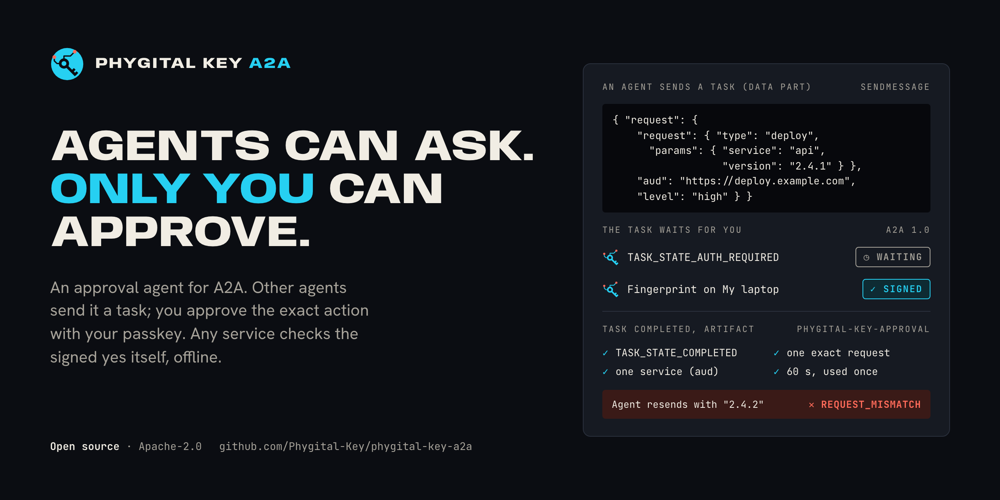
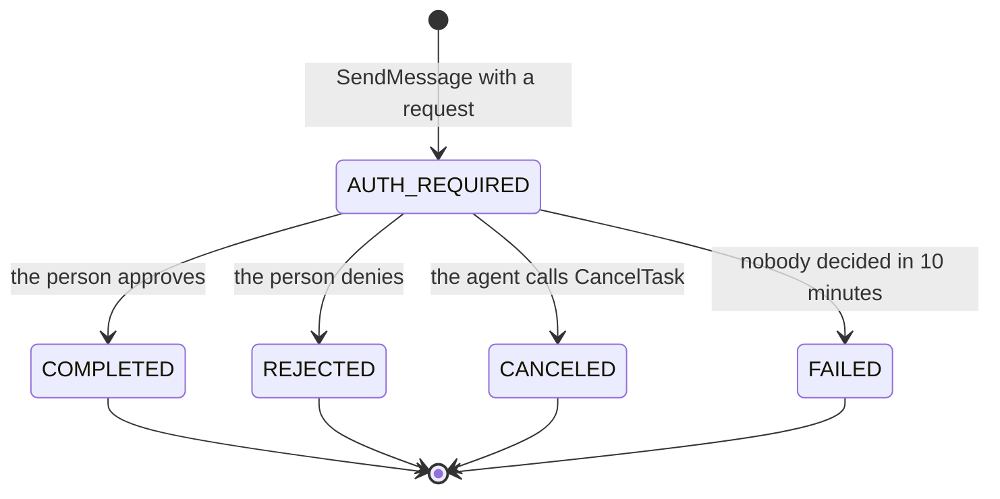

<p align="center"></p>

<h1 align="center">Phygital Key A2A</h1>

<p align="center"><b>Other agents ask through A2A. You approve the exact action with your passkey. The service checks your signed yes itself, offline.</b></p>

<p align="center">
<a href="#open-source-and-credit"></a>
<a href="LICENSE"></a>
<a href="https://github.com/Phygital-Key/phygital-key-a2a/actions/workflows/ci.yml"></a>
<a href="https://github.com/Phygital-Key/phygital-key-a2a/releases/latest"></a>
<a href="Cargo.toml"></a>
<a href="https://a2a-protocol.org/latest/specification/"></a>
<a href="https://github.com/Phygital-Key/phygital-key-a2a/stargazers"></a>
<a href="https://github.com/Phygital-Key/phygital-key-a2a/commits/main"></a>
<a href="https://scorecard.dev/viewer/?uri=github.com/Phygital-Key/phygital-key-a2a"></a>
</p>

<p align="center">
<a href="https://github.com/Phygital-Key/phygital-key/blob/main/docs/webauthn.md"></a>
<a href="docs/testing.md"></a>
<a href="docs/testing.md#a2a-conformance-kit"></a>
<a href="https://github.com/Phygital-Key/phygital-key/blob/main/docs/secure-install.md"></a>
<a href="https://github.com/Phygital-Key/phygital-key/blob/main/docs/threat-model.md"></a>
<a href="https://github.com/Phygital-Key/phygital-key/blob/main/docs/updates.md"></a>
<a href="Cargo.toml"></a>
<a href="https://github.com/Phygital-Key/phygital-key/blob/main/docs/privacy.md"></a>
</p>

<p align="center"><b>Free and open source under the Apache-2.0 license.</b> Keep the <code>NOTICE</code> file. See <a href="#open-source-and-credit">Open source and credit</a>.</p>

<p align="center">
<a href="#install">Install</a> ·
<a href="#try-it">Try it</a> ·
<a href="#connect-an-agent">Connect an agent</a> ·
<a href="#the-message-shapes">Messages</a> ·
<a href="#conformance">Conformance</a> ·
<a href="#all-the-guides">Guides</a>
</p>

> [!WARNING]
> **Pre-audit, and not released yet.** No outside security firm has reviewed it. The install commands below work from the first release, v0.1.0. Read the [threat model](https://github.com/Phygital-Key/phygital-key/blob/main/docs/threat-model.md) and the [security reviews](https://github.com/Phygital-Key/phygital-key/blob/main/docs/security-reviews.md) before you rely on it.

## What it is

Phygital Key A2A is a [Phygital Key](https://github.com/Phygital-Key/phygital-key) product for agents that speak [A2A](https://a2a-protocol.org/latest/specification/) (the Agent2Agent protocol, version 1.0). It is one program, `phygital-key-a2a`, that runs an A2A agent and the [approval page](https://github.com/Phygital-Key/phygital-key/blob/main/docs/glossary.md#approval-page).

It is an approval agent. Before another agent deploys, pays, deletes or sends, it sends this agent a message with the exact request. You read that request on the approval page and approve it with a passkey, fingerprint, face, PIN or hardware key. Your key signs the exact request (WebAuthn, ES256 on P-256). The asking agent gets the signed approval back as a task artifact and hands it to the service, and the service checks it itself, offline, before it acts.

The agent can never approve. No message, task state, metadata or text counts as a yes: only your key's signature on the approval page does. A request changed by one character is refused by the service with `REQUEST_MISMATCH`. Approvals are signed, not encrypted: keep passwords and card numbers out of requests.

The approval page, the keys, standing approvals, receipts, the audit log, the secure install and signed updates come from the shared base, [Phygital-Key/phygital-key](https://github.com/Phygital-Key/phygital-key). This repository adds the A2A side. For AI apps that speak MCP, see [Phygital Key MCP](https://github.com/Phygital-Key/phygital-key-mcp).

## How it maps onto A2A

A request for approval becomes an A2A task. The task id is the gate's request id.



| Task state | What it means | What the asking agent does |
|---|---|---|
| `TASK_STATE_AUTH_REQUIRED` | Waiting for the person. The status message holds the `approveUrl`. | Show the person the link, then stream, subscribe or poll. |
| `TASK_STATE_COMPLETED` | The person approved. The task has one artifact, `phygital-key-approval`, with the signed `approval`, `exp` and `approvedBy`. | Send the approval with the exact action, once, to the one service it names. |
| `TASK_STATE_REJECTED` | The person said no. | Do not act. |
| `TASK_STATE_CANCELED` | The agent withdrew it. | Do not act. |
| `TASK_STATE_FAILED` | Nobody decided within 10 minutes, or the approval ran out before it was collected. | Do not act. |

A task leaves `TASK_STATE_AUTH_REQUIRED` once, and an ended task never changes again. Every state, message and error: [protocol](docs/protocol.md) and the [extension profile](docs/extension.md).

## Install

| Where | Command |
|---|---|
| macOS, Linux (Homebrew) | `brew install phygital-key/tap/phygital-key-a2a` |
| macOS, Linux (script) | `curl -fsSL https://raw.githubusercontent.com/Phygital-Key/phygital-key-a2a/main/install.sh \| sh` |
| Anywhere with Rust | `cargo install --locked --git https://github.com/Phygital-Key/phygital-key-a2a phygital-key-a2a` |
| Server (Docker) | `docker run -d --name phygital-key-a2a -p 127.0.0.1:7478:7478 -v phygital-key-a2a:/data ghcr.io/phygital-key/phygital-key-a2a:latest` |
| Manual, also Windows | Download from [Releases](https://github.com/Phygital-Key/phygital-key-a2a/releases) (each archive has a `.sha256`, and `release.txt` lists every SHA-256, signed in `release.txt.sig`) |

All of these work from the first release, v0.1.0. Releases are built for Linux (x86_64, arm64), macOS (Apple silicon, Intel) and Windows (x86_64).

The script downloads the latest release for your machine, checks that its file list (`release.txt`) is signed by a release key pinned in the script and that the download matches its SHA-256, then writes only `~/.local/bin/phygital-key-a2a`. It needs `curl`, `tar` and `openssl`. Update later with `phygital-key-a2a update`.

The container runs `phygital-key-a2a --bind 0.0.0.0 serve` as user `65532` with its data in `/data` (`PHYGITAL_KEY_A2A_HOME=/data`). Add your key with `docker exec -it phygital-key-a2a phygital-key-a2a enroll` and get the access token with `docker exec -it phygital-key-a2a phygital-key-a2a token`. Publish the port on `127.0.0.1` only, or put a TLS proxy in front and pass `--origin https://your.host` ([own server](https://github.com/Phygital-Key/phygital-key/blob/main/docs/own-server.md)).

To run the gate out of reach of the agents on the same machine (macOS, Linux), use the [secure install](https://github.com/Phygital-Key/phygital-key/blob/main/docs/secure-install.md) from a fresh terminal:

```bash
curl -q -fsSL https://raw.githubusercontent.com/Phygital-Key/phygital-key-a2a/v0.1.0/install-service.sh | sudo bash
```

It downloads the official release itself, checks it against the signed release list, and runs it as its own system user: `_phygitalkeya2a` under `/Library/PhygitalKey/a2a` on macOS (launchd labels `io.phygitalkey.a2a.gate` and `io.phygitalkey.a2a.update`), `phygitalkey-a2a` with `/usr/lib/phygital-key-a2a` and `/var/lib/phygital-key-a2a` on Linux (systemd units `phygital-key-a2a.service` and `phygital-key-a2a-update.{service,timer}`). Then `phygital-key-a2a-admin enroll` adds your key, `phygital-key-a2a-admin token` prints the connection details, and `phygital-key-a2a-admin status` checks that the real gate is the one answering. Each admin command asks for your administrator password.

## Try it

```bash
phygital-key-a2a demo
```

The demo starts the gate on `http://localhost:7478` and a fake service on `http://localhost:7479` that acts only with a valid approval (`/deploy`, `/payment`, `/send_message`; nothing real happens). It prints a one-time link to add your passkey (valid 10 minutes), the agent card, the endpoint with your token, and a `curl` line to try. The full walk-through, with real outputs: [getting started](docs/getting-started.md).

## Connect an agent

| What | Value |
|---|---|
| Agent card | `GET http://localhost:7478/.well-known/agent-card.json` (public, no token) |
| Endpoint | `POST http://localhost:7478/a2a`, JSON-RPC 2.0, `Content-Type: application/json` or `application/a2a+json` |
| Headers on every call | `Authorization: Bearer <token>` and `A2A-Version: 1.0` |
| The token | `phygital-key-a2a token` prints it (it lives in `<home>/access-token`, mode 0600) |
| Methods | `SendMessage`, `SendStreamingMessage`, `GetTask`, `ListTasks`, `CancelTask`, `SubscribeToTask` |
| Not supported | push notifications (`-32003`), the extended agent card (`-32004`), gRPC and HTTP+JSON bindings, stdio |

The card declares streaming (yes), push notifications (no), one bearer security scheme and five skills: `request_approval`, `request_standing_approval`, `use_standing_approval`, `record_receipt` and `revoke_standing_approval`. None of them can approve.

Any A2A 1.0 client that reads the card and sends the bearer header works. The [official JavaScript client](https://www.npmjs.com/package/@a2a-js/sdk) (`@a2a-js/sdk` 1.3.0) runs in every end-to-end test. Examples in JavaScript, Python and `curl`, polling and streaming: [connect your agent](docs/connect-your-agent.md).

## The message shapes

Every message to this agent has one data part (`mediaType: application/json`) whose object has exactly one key:

| Key | What it asks | The answer |
|---|---|---|
| `request` | A one-time approval: `{"request": {"type", "params"}, "aud", "level"}` | A task in `TASK_STATE_AUTH_REQUIRED` |
| `standing` | A [standing approval](https://github.com/Phygital-Key/phygital-key/blob/main/docs/standing-approvals.md): `{"for_type", "fixed", "vary", "max_uses", "days", "aud"}` | A task in `TASK_STATE_AUTH_REQUIRED` |
| `use` | One use of an approved standing approval: `{"standingId", "request"}` | A message with `approval`, `useToken`, `usesLeft` |
| `receipt` | Pass back the service's signed receipt: `{"id", "receipt"}` | A message with `serviceReported` |
| `revoke` | Stop a standing approval: `{"standingId"}` | A message with `revoked` and the `signUrl` for the person |

The smallest request:

```json
{"data": {"request": {
  "request": {"type": "deploy", "params": {"service": "api", "env": "production", "version": "2.4.1"}},
  "aud": "https://deploy.example.com",
  "level": "high"
}}, "mediaType": "application/json"}
```

`level` is `medium` (a touch on the key) or `high` (fingerprint, face or PIN). `aud` is the one service that will act on the yes. Text parts next to the data part are ignored. A message without a valid data part gets a `ROLE_AGENT` message back that lists these shapes, never a task. The full profile, with every field and the approval artifact: [docs/extension.md](docs/extension.md).

## Conformance

The official [A2A conformance kit](https://github.com/a2aproject/a2a-tck) (`a2a-tck`, pinned commit `263b9cf`) runs in CI at the MUST level on the JSON-RPC binding:

| Build | Result | Why |
|---|---|---|
| Test build, `cargo build --features tck` | 81 passed, 0 failed | The kit drives its scenarios through messages whose `messageId` starts with `tck-` (complete a task, add artifacts, ask for input, stream updates). Only this build answers them, and those tasks never reach the gate. |
| Release build (no features) | Cannot run | The kit connects without the access token, and a release build refuses `--no-token` (exit code 2). Its scenarios also need an agent that completes tasks on its own, while this agent completes a task only after a person's signed approval. |

The release workflow never enables the `tck` feature. Only a `tck` build accepts `--no-token`, and the connection details it prints start with a warning that it must never be used for real approvals. How to run the kit yourself: [testing](docs/testing.md#a2a-conformance-kit).

## All the guides

Shared guides live in the base repository: **[all the guides](https://github.com/Phygital-Key/phygital-key#all-the-guides)** (approving, keys, standing approvals, secure install, checking approvals in your service, security). Guides for one product (connecting AI apps, its agent tools, prompts) live in that product's repository.

This product's guides: [Getting started](docs/getting-started.md) · [Connect your agent](docs/connect-your-agent.md) · [Protocol](docs/protocol.md) · [Extension](docs/extension.md) · [Testing](docs/testing.md)

## This repository

| Path | What |
|---|---|
| [`src/main.rs`](src/main.rs) | The product (name, program, port, release keys) and the A2A adapter |
| [`src/card.rs`](src/card.rs) | The public agent card at `/.well-known/agent-card.json` |
| [`src/server.rs`](src/server.rs), [`src/rpc.rs`](src/rpc.rs) | The JSON-RPC endpoint at `/a2a`, the methods, the errors and the streams |
| [`src/intent.rs`](src/intent.rs), [`src/proto.rs`](src/proto.rs), [`src/store.rs`](src/store.rs) | The accepted message shapes, the A2A objects and task states, the task store |
| [`src/tck.rs`](src/tck.rs) | Test behaviours for the conformance kit, compiled only with `--features tck` |
| [`tests/e2e/`](tests/e2e) | 165 end-to-end and red-team checks: release binary, Chromium with a virtual passkey, the official A2A client, the demo service |
| [`docs/`](docs) | [Getting started](docs/getting-started.md), [connect your agent](docs/connect-your-agent.md), [protocol](docs/protocol.md), [extension](docs/extension.md), [testing](docs/testing.md) |
| [`packaging/container/`](packaging/container) | The container image |
| `install.sh`, `install-service.sh`, `tests/secure-install.sh`, `scripts/` | Made from the base's templates for this product. Never edited by hand: see [AGENTS.md](AGENTS.md) |

Changes: [CHANGELOG.md](CHANGELOG.md). Security problems: [SECURITY.md](SECURITY.md). Contributing: [CONTRIBUTING.md](CONTRIBUTING.md).

## Open source and credit

Phygital Key A2A is free and open source under the [Apache-2.0](LICENSE) license. You can use it at home or at work, change it, ship it in a product and sell that product. You can read every line that handles your approvals, and check the release you run against its signed SHA-256.

The one thing to keep: the [`NOTICE`](NOTICE) file, with the line "Created by Phygital-Key", in every copy or changed version (Apache-2.0, section 4(d)).

Provided "as is", without warranty of any kind, as the [license](LICENSE) says. It is pre-audit: try it with the demo first, read the threat model, and keep a second key enrolled.

[Apache-2.0](LICENSE). Created by Phygital-Key.
