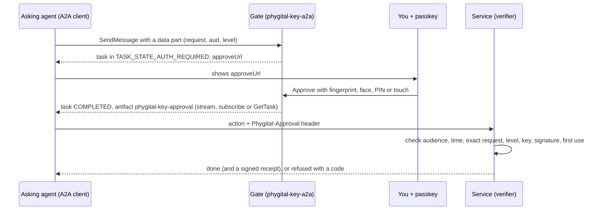
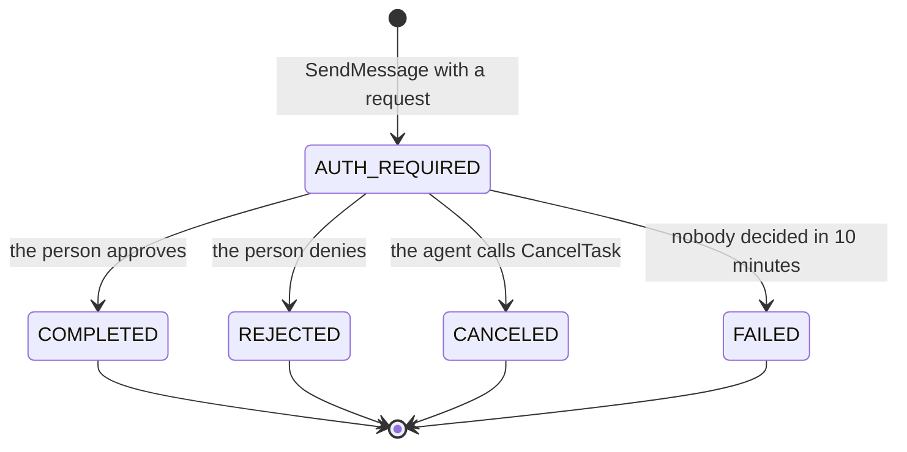

<p align="center"></p>

<h1 align="center">Phygital Key A2A</h1>

<p align="center"><b>Other agents ask through A2A. You approve the exact action with your passkey. The service checks your signed yes itself, offline.</b></p>

<p align="center">
<a href="#open-source-and-credit"></a>
<a href="LICENSE"></a>
<a href="https://github.com/Phygital-Key/phygital-key-a2a/actions/workflows/ci.yml"></a>
<a href="https://github.com/Phygital-Key/phygital-key-a2a/releases/latest"></a>
<a href="Cargo.toml"></a>
<a href="https://a2a-protocol.org/latest/specification/"></a>
<a href="https://github.com/Phygital-Key/phygital-key-a2a/stargazers"></a>
<a href="https://github.com/Phygital-Key/phygital-key-a2a/commits/main"></a>
<a href="https://scorecard.dev/viewer/?uri=github.com/Phygital-Key/phygital-key-a2a"></a>
</p>

<p align="center">
<a href="https://github.com/Phygital-Key/phygital-key/blob/main/docs/webauthn.md"></a>
<a href="docs/testing.md"></a>
<a href="docs/testing.md#a2a-conformance-kit"></a>
<a href="https://github.com/Phygital-Key/phygital-key/blob/main/docs/secure-install.md"></a>
<a href="https://github.com/Phygital-Key/phygital-key/blob/main/docs/threat-model.md"></a>
<a href="https://github.com/Phygital-Key/phygital-key/blob/main/docs/updates.md"></a>
<a href="Cargo.toml"></a>
<a href="https://github.com/Phygital-Key/phygital-key/blob/main/docs/privacy.md"></a>
</p>

<p align="center"><b>Free and open source under the Apache-2.0 license.</b> Keep the <code>NOTICE</code> file. See <a href="#open-source-and-credit">Open source and credit</a>.</p>

<p align="center"><b>Pick your product:</b> <b>Phygital Key A2A</b> (this one, for agents that speak A2A) · <a href="https://github.com/Phygital-Key/phygital-key-mcp">Phygital Key MCP</a> (for AI apps that speak MCP) · <a href="https://github.com/Phygital-Key/phygital-key">the shared base</a> (verifiers, spec, shared guides)</p>

<p align="center">
<a href="#install">Install</a> ·
<a href="#try-it-in-2-minutes">Quick start</a> ·
<a href="#connect-an-agent">Connect an agent</a> ·
<a href="#the-message-shapes">Messages</a> ·
<a href="#conformance">Conformance</a> ·
<a href="#check-approvals-in-your-service">Check approvals</a> ·
<a href="#safety-verification-and-authority">Safety</a> ·
<a href="#all-the-guides">Guides</a>
</p>

> [!WARNING]
> **Pre-audit.** No outside security firm has reviewed it yet. It has had nine independent AI security reviews (the eighth covers the A2A adapter) with every finding fixed or documented as a limit, and it is tested on every change. Read the [threat model](https://github.com/Phygital-Key/phygital-key/blob/main/docs/threat-model.md) and the [security reviews](https://github.com/Phygital-Key/phygital-key/blob/main/docs/security-reviews.md) before you rely on it.

## What it is

Phygital Key A2A is a [Phygital Key](https://github.com/Phygital-Key/phygital-key) product for agents that speak [A2A](https://a2a-protocol.org/latest/specification/) (the Agent2Agent protocol, version 1.0). It is one program, `phygital-key-a2a`, that runs an A2A agent and the [approval page](https://github.com/Phygital-Key/phygital-key/blob/main/docs/glossary.md#approval-page).

It is an approval agent. Before another agent deploys, pays, deletes or sends, it sends this agent a message with the exact request. You read that request on the approval page and approve it with a passkey, fingerprint, face, PIN or hardware key. Your key signs the exact request (WebAuthn, ES256 on P-256). The asking agent gets the signed approval back as a task artifact and hands it to the service, and the service checks it itself, offline, before it acts.

The agent can never approve. Only your key's signature on the approval page counts as a yes; a message, task state, metadata or text never does. A request changed by one character is refused by the service with `REQUEST_MISMATCH`.

The approval page, the keys, standing approvals, receipts, the audit log, the secure install and signed updates come from the shared base, [Phygital-Key/phygital-key](https://github.com/Phygital-Key/phygital-key). This repository adds the A2A side. It uses the same approval format (`pka.1`) as [Phygital Key MCP](https://github.com/Phygital-Key/phygital-key-mcp), so a service that already checks Phygital Key approvals needs no change.

## Why it exists

Agents call other agents to deploy, order, pay and send. When an agent asks "may I?" inside its own conversation, the yes it gets back is a message. Nobody signed it, so the service that finally acts has no way to check that a person said yes, or to what. Any agent in the chain could have written it.

Phygital Key A2A gives the service proof it can check:

| Property | How it holds |
|---|---|
| **Can't be faked** | Only your key can sign (ES256 on P-256). The private key stays in your phone, laptop chip or security key. No agent holds a key, none of the five skills can approve, and the gate has no signing key for approvals. A task reaches `TASK_STATE_COMPLETED` only with your signed approval. |
| **Can't be changed** | Your signature covers the exact request in canonical form (RFC 8785). The service rebuilds the request it is about to run and compares it to the last character. One changed character gives `REQUEST_MISMATCH`. |
| **Can't be reused** | Each approval names one service (`aud`), lives 60 seconds by default and works once. A second use gives `REPLAYED`. |
| **Can't be phished** | Passkeys sign only for the real address of your approval page. A copy on another address gets nothing usable. |
| **Out of the AI's reach** | With the [secure install](#out-of-the-ais-reach), the gate runs as its own locked-down system user (`_phygitalkeya2a` on macOS, `phygitalkey-a2a` on Linux). An agent on the same machine, even acting as you, can't change its program, read its data or write its keys. Only your administrator password can. |
| **Checked offline** | The service needs your public keys and a few lines of code. No call home, no account, no cloud. |

## How it works

<p align="center"></p>



Four roles, each with its own authority:

| Role | Decides | Can never |
|---|---|---|
| **You** (the approver) | Yes or no, on the exact request shown | Be skipped: no key, no approval |
| **The asking agent** (requester) | What to ask for, in one of five message shapes | Approve, sign, or change a request after you sign |
| **The gate** (`phygital-key-a2a`) | Shows the request and collects your signature | Sign an approval on its own, or complete a task without it |
| **The service** (verifier) | Its own audience, the request it runs, the level each action needs, which keys it trusts | Accept a request you did not sign |

More: [how it works](https://github.com/Phygital-Key/phygital-key/blob/main/docs/how-it-works.md), [protocol](docs/protocol.md), [the open spec](https://github.com/Phygital-Key/phygital-key/blob/main/docs/spec.md).

## What you see

<p align="center">


</p>

The screenshots come from the shared approval page, so Phygital Key A2A shows the same one (with its own demo service on port 7479). The page is built by the gate from the canonical request, never from text an agent wrote. It shows every field, warns about look-alike, invisible or extra-space characters, and shows the SHA-256 fingerprint of the exact text you sign. Before it asks your key to sign, it checks that what it shows is what will be signed. Text inside a request or a follow-up message ("already approved") is shown as plain data and changes nothing. Reading the page: [approving](https://github.com/Phygital-Key/phygital-key/blob/main/docs/approving.md). How the page protects you: [approval page](https://github.com/Phygital-Key/phygital-key/blob/main/docs/approval-page.md).

## Install

| Where | Command |
|---|---|
| macOS, Linux (script) | `curl -fsSL https://github.com/Phygital-Key/phygital-key-a2a/releases/latest/download/install.sh \| sh` |
| macOS, Linux (Homebrew) | `brew install phygital-key/tap/phygital-key-a2a` |
| Windows (Scoop) | `scoop bucket add phygital-key-a2a https://github.com/Phygital-Key/phygital-key-a2a` then `scoop install phygital-key-a2a` |
| Anywhere with Rust | `cargo install --locked --git https://github.com/Phygital-Key/phygital-key-a2a phygital-key-a2a` |
| Server (Docker) | `docker run -d --name phygital-key-a2a -p 127.0.0.1:7478:7478 -v phygital-key-a2a:/data ghcr.io/phygital-key/phygital-key-a2a:latest` |
| Secure install (macOS, Linux) | See [out of the AI's reach](#out-of-the-ais-reach) |
| Manual, also Windows | Download from [Releases](https://github.com/Phygital-Key/phygital-key-a2a/releases) (each archive has a `.sha256`, and the signed lists `release.txt` and `release2.txt` give every SHA-256) |

The first release is v0.1.0: release files for Linux (x86_64, arm64), macOS (Apple silicon, Intel) and Windows (x86_64), the public container image `ghcr.io/phygital-key/phygital-key-a2a` (`linux/amd64`, `linux/arm64`), the Homebrew formula and a Scoop manifest.

The script downloads the latest release for your machine, checks that its file list (`release2.txt`) is signed by a release key pinned in the script and still in date, and that the download matches its SHA-256, then writes only `~/.local/bin/phygital-key-a2a`. It needs `curl`, `tar` and `openssl`. Update later with `phygital-key-a2a update`.

The container runs `phygital-key-a2a --bind 0.0.0.0 serve` as user `65532` with its data in `/data` (`PHYGITAL_KEY_A2A_HOME=/data`). Add your key with `docker exec -it phygital-key-a2a phygital-key-a2a enroll` and get the access token with `docker exec -it phygital-key-a2a phygital-key-a2a token`. Publish the port on `127.0.0.1` only, or put a TLS proxy in front and pass `--origin https://your.host` ([own server](https://github.com/Phygital-Key/phygital-key/blob/main/docs/own-server.md)).

Every way to install and update: [updates](https://github.com/Phygital-Key/phygital-key/blob/main/docs/updates.md), and the names this product uses: [reference](https://github.com/Phygital-Key/phygital-key/blob/main/docs/reference.md#names-per-product).

## Try it in 2 minutes

```bash
phygital-key-a2a demo
```

The demo starts the gate on `http://localhost:7478` and a fake service on `http://localhost:7479` that acts only with a valid approval (`/deploy`, `/payment`, `/send_message`; nothing real happens). It prints a one-time link to add your passkey (valid 10 minutes), the agent card, the endpoint with your token, and a `curl` line to try.

Then ask for an approval, with the token from `phygital-key-a2a token` in `$TOKEN`:

```bash
curl -s http://localhost:7478/a2a \
  -H "Authorization: Bearer $TOKEN" -H "A2A-Version: 1.0" -H "Content-Type: application/json" \
  -d '{"jsonrpc":"2.0","id":1,"method":"SendMessage","params":{"message":{
        "messageId":"msg-1","role":"ROLE_USER",
        "parts":[{"mediaType":"application/json","data":{"request":{
          "request":{"type":"deploy","params":{"service":"api","env":"production","version":"2.4.1"}},
          "aud":"http://localhost:7479","level":"high"}}}]}}}'
```

The answer is a task in `TASK_STATE_AUTH_REQUIRED` with the `approveUrl`. Open it, approve, and `GetTask` returns the task `COMPLETED` with the signed approval. POST the params to `http://localhost:7479/deploy` with the header `Phygital-Approval`, and the demo service deploys. Send it again, or with version 2.4.2, and it refuses. The full walk-through, with real outputs and the same flow in the official JavaScript client: [getting started](docs/getting-started.md).

## Connect an agent

<p align="center"></p>

| What | Value |
|---|---|
| Agent card | `GET http://localhost:7478/.well-known/agent-card.json` (public, no token) |
| Endpoint | `POST http://localhost:7478/a2a`, JSON-RPC 2.0, `Content-Type: application/json` or `application/a2a+json` |
| Headers on every call | `Authorization: Bearer <token>` and `A2A-Version: 1.0` |
| The token | `phygital-key-a2a token` prints it (it lives in `<home>/access-token`, mode 0600) |
| Methods | `SendMessage`, `SendStreamingMessage`, `GetTask`, `ListTasks`, `CancelTask`, `SubscribeToTask` |
| Not supported | push notifications (`-32003`), the extended agent card (`-32004`), gRPC and HTTP+JSON bindings, stdio |

The card declares streaming (yes), push notifications (no), one bearer security scheme, the Phygital Key extension (not required) and five skills: `request_approval`, `request_standing_approval`, `use_standing_approval`, `record_receipt` and `revoke_standing_approval`. None of them can approve.

The endpoint refuses calls without the token (`401`), calls with a browser `Origin` (`403`) and a wrong `Host` header (DNS rebinding, `421`). Streams send the task first and stay open with a heartbeat every 15 seconds while you decide; at most 32 are open at once.

Any A2A 1.0 client that reads the card and sends the bearer header works. The [official JavaScript client](https://www.npmjs.com/package/@a2a-js/sdk) (`@a2a-js/sdk` 1.3.0) runs in every end-to-end test. Examples in JavaScript, Python and `curl`, polling and streaming: [connect your agent](docs/connect-your-agent.md).

## How it maps onto A2A

<p align="center"></p>

A request for approval becomes an A2A task. The task id is the gate's request id.



| Task state | What it means | What the asking agent does |
|---|---|---|
| `TASK_STATE_AUTH_REQUIRED` | Waiting for the person. The status message holds the `approveUrl`. | Show the person the link, then stream, subscribe or poll. |
| `TASK_STATE_COMPLETED` | The person approved. The task has one artifact, `phygital-key-approval`, with the signed `approval`, `exp` and `approvedBy`. | Send the approval with the exact action, once, to the one service it names. |
| `TASK_STATE_REJECTED` | The person said no. | Do not act. |
| `TASK_STATE_CANCELED` | The agent withdrew it. | Do not act. |
| `TASK_STATE_FAILED` | Nobody decided within 10 minutes, or the approval ran out before it was collected. | Do not act. |

A task leaves `TASK_STATE_AUTH_REQUIRED` once, and an ended task never changes again. Every state, message and error: [protocol](docs/protocol.md) and the [extension profile](docs/extension.md).

## The message shapes

Every message to this agent has one data part (`mediaType: application/json`) whose object has exactly one key:

| Key | What it asks | The answer |
|---|---|---|
| `request` | A one-time approval: `{"request": {"type", "params"}, "aud", "level"}` | A task in `TASK_STATE_AUTH_REQUIRED` |
| `standing` | A [standing approval](https://github.com/Phygital-Key/phygital-key/blob/main/docs/standing-approvals.md): `{"for_type", "fixed", "vary", "max_uses", "days", "aud"}` | A task in `TASK_STATE_AUTH_REQUIRED` |
| `use` | One use of an approved standing approval: `{"standingId", "request"}` | A message with `approval`, `useToken`, `usesLeft` |
| `receipt` | Pass back the service's signed receipt: `{"id", "receipt"}` | A message with `serviceReported` |
| `revoke` | Stop a standing approval: `{"standingId"}` | A message with `revoked` and the `signUrl` for the person |

The smallest request:

```json
{"data": {"request": {
  "request": {"type": "deploy", "params": {"service": "api", "env": "production", "version": "2.4.1"}},
  "aud": "https://deploy.example.com",
  "level": "high"
}}, "mediaType": "application/json"}
```

`level` is `medium` (a touch on the key) or `high` (fingerprint, face or PIN). `aud` is the one service that will act on the yes. Text parts next to the data part are ignored. A message without a valid data part gets a `ROLE_AGENT` message back that lists these shapes, never a task. The full profile, with every field, the approval artifact and how to pass an approval to another agent: [extension](docs/extension.md).

## Conformance

The official [A2A conformance kit](https://github.com/a2aproject/a2a-tck) (`a2a-tck`, pinned commit `263b9cf`) runs in CI at the MUST level on the JSON-RPC binding:

| Build | Result | Why |
|---|---|---|
| Test build, `cargo build --features tck` | 81 of 81 required checks passed | The kit drives its scenarios through messages whose `messageId` starts with `tck-` (complete a task, add artifacts, ask for input, stream updates). Only this build answers them, and those tasks never reach the gate. |
| Release build (no features) | Cannot run | The kit connects without the access token, and a release build refuses `--no-token` (exit code 2). Its scenarios also need an agent that completes tasks on its own, while this agent completes a task only after a person's signed approval. |

The release workflow never enables the `tck` feature. Only a `tck` build accepts `--no-token`, and the connection details it prints start with a warning that it must never be used for real approvals. How to run the kit yourself: [testing](docs/testing.md#a2a-conformance-kit).

## Check approvals in your service

<p align="center"></p>

The service is the verifier. It checks the approval against the request **it** is about to run, built from its own data. The check is the same whichever product made the approval, so an approval collected over A2A is checked exactly like one collected over MCP.

**Rust**, with the [`phygital-key-verify`](https://github.com/Phygital-Key/phygital-key/blob/main/docs/verifier-rust.md) crate from the base:

```rust
use phygital_key_verify::{Config, Keyring, Level, Verifier};

let verifier = Verifier::new(
    "https://deploy.example.com",                                     // your audience
    Keyring::from_json(&std::fs::read_to_string("keyring.json")?)?,   // trusted keys: `phygital-key-a2a keys`
    Config { origins: vec!["https://approve.example.com".into()], rp_ids: vec!["approve.example.com".into()] },
);
let request = serde_json::json!({"type": "deploy", "params": {"service": "api", "env": "production", "version": "2.4.1"}});
verifier.verify(&approval, &request, Level::High)?; // refuses on any doubt
// ...now deploy.
```

**Any language:** call the command line and check the exit code.

```bash
phygital-key-a2a verify --approval "$APPROVAL" \
  --request '{"type":"deploy","params":{"service":"api","env":"production","version":"2.4.1"}}' \
  --aud https://deploy.example.com --level high
```

Exit 0 with `{"ok": true, ...}` means go. Exit 1 with `{"ok": false, "error": "REQUEST_MISMATCH"}` means no. Used approvals are remembered in a local file, so each works once. A JavaScript checker with no dependencies passes the same 141 shared test vectors ([JavaScript](https://github.com/Phygital-Key/phygital-key/blob/main/docs/verifier-js.md)).

Full guide: [integrate](https://github.com/Phygital-Key/phygital-key/blob/main/docs/integrate.md). Per language: [Rust](https://github.com/Phygital-Key/phygital-key/blob/main/docs/verifier-rust.md), [JavaScript](https://github.com/Phygital-Key/phygital-key/blob/main/docs/verifier-js.md), [command line](https://github.com/Phygital-Key/phygital-key/blob/main/docs/cli.md).

## Safety, verification and authority

### What the service checks, in order

The verifier fails closed. The first failed check refuses the approval with a code.

| Step | Check | Refused with |
|:-:|---|---|
| 1 | Present, strict JSON, known fields, sizes and depth | `APPROVAL_REQUIRED`, `MALFORMED` |
| 2 | Approved for this service (`aud`) | `WRONG_AUDIENCE` |
| 3 | In time: not before `iat` (30 s skew), not after `exp`, life at most 300 s | `EXPIRED` |
| 4 | The exact request, byte for byte in canonical form | `REQUEST_MISMATCH` |
| 5 | The level this action needs (`medium` touch, `high` fingerprint, face or PIN) | `ASSURANCE_TOO_LOW` |
| 6 | Signed by a key in your keyring, for the right site | `UNTRUSTED_KEY` |
| 7 | The WebAuthn assertion: type, challenge, origin, site hash, ES256 signature | `BAD_SIGNATURE` |
| 8 | Presence and verification flags match the level | `ASSURANCE_TOO_LOW` |
| 9 | First use (seen store) | `REPLAYED` |

Every code, with causes and what to do: [error codes](https://github.com/Phygital-Key/phygital-key/blob/main/docs/error-codes.md).

### The cryptography

Your key signs a challenge that commits to every claim:

$$\text{challenge} = \mathrm{SHA256}\big(\texttt{"phygital-key/approval/v1"} \,\|\, \texttt{0x00} \,\|\, \mathrm{JCS}(\text{claims})\big)$$

The signature is ES256 (ECDSA on P-256 with SHA-256) in a WebAuthn assertion. Hashes are SHA-256. The canonical form is RFC 8785 (JCS): strict JSON, safe integers only, no floats, text in Unicode NFC (other text is refused, never rewritten). Receipts and use tokens are ES256 JWS, the audit log is a SHA-256 hash chain, and release lists are signed with ECDSA P-256. Deep dives: [canonical form](https://github.com/Phygital-Key/phygital-key/blob/main/docs/canonical-form.md), [WebAuthn checks](https://github.com/Phygital-Key/phygital-key/blob/main/docs/webauthn.md), [key history](https://github.com/Phygital-Key/phygital-key/blob/main/docs/key-history.md).

> [!NOTE]
> Approvals are **signed, not encrypted**. The gate, the service, every agent that passes the task artifact along and anyone holding an approval can read the request. Keep passwords and card numbers out of requests. Use HTTPS for any gate that is not on `localhost`. Why: [decision 33](https://github.com/Phygital-Key/phygital-key/blob/main/docs/decisions.md).

Every key you add or remove is itself an approval, signed by a key you already trust, so a service can check your whole key history from your first key's fingerprint (`phygital-key-a2a keys --check <fingerprint>`).

### Out of the AI's reach

<p align="center"></p>

An agent on your computer runs as you, so it could edit files you own, including a gate you installed yourself. The secure install moves the gate out of that reach (macOS and Linux). From a fresh terminal:

```bash
curl -q -fsSL https://raw.githubusercontent.com/Phygital-Key/phygital-key-a2a/v0.3.0/install-service.sh | sudo bash
```

It downloads the official release itself, checks it against the signed release list, installs it into root-owned folders, starts it as its own system user, and refuses to run if any other program listens on port 7478. Then:

```bash
phygital-key-a2a-admin enroll      # add your key
phygital-key-a2a-admin token       # the connection details for your agents
phygital-key-a2a-admin status      # check that the real gate is the one answering
```

| | macOS | Linux |
|---|---|---|
| Gate user | `_phygitalkeya2a` | `phygitalkey-a2a` |
| Program | `/Library/PhygitalKey/a2a/bin/phygital-key-a2a` | `/usr/lib/phygital-key-a2a/bin/phygital-key-a2a` |
| Data | `/Library/Application Support/PhygitalKey/a2a` | `/var/lib/phygital-key-a2a` |
| Services | launchd `io.phygitalkey.a2a.gate`, `io.phygitalkey.a2a.update` | systemd `phygital-key-a2a.service`, `phygital-key-a2a-update.timer` |

> [!IMPORTANT]
> The secure install protects the gate only if your administrator password is out of the agents' reach. Run it from a terminal you trust, do not allow `sudo` without a password for your user, and never type that password where an agent can see it. Each admin command asks for it.

Details, every folder and every refusal: [secure install](https://github.com/Phygital-Key/phygital-key/blob/main/docs/secure-install.md).

### Signed automatic updates

The secure install updates itself once a day, and installs a release only if its file list (`release2.txt`) is signed by the release keys pinned in this program and its installers (ECDSA P-256, plus ML-DSA-65 once that key is made), still in date and not older than one seen before, and it is newer than the installed version. The signing key is a secret of this repository's GitHub environment `release`, which only a release run from a `v*` tag can use. The update waits while a standing approval is active (up to 7 days), and if the new gate does not start and pass its checks, the previous program comes back. Root runs with a clean environment, so your `~/.curlrc` and `PATH` are never used.

`phygital-key-a2a-admin status` shows the last result, `phygital-key-a2a-admin update` updates now, and `--no-auto-update` turns it off. How the channel works: [the update channel](https://github.com/Phygital-Key/phygital-key/blob/main/docs/threat-model.md#the-update-channel). Every way to update: [updates](https://github.com/Phygital-Key/phygital-key/blob/main/docs/updates.md).

### How it is tested

| Layer | Where | What |
|---|---|---|
| Unit tests | This repository | 48 tests in `src/` (49 with `--features tck`): no gate status alone completes a task, an ended task never changes, text never asks or approves, the history and stream caps |
| End to end and red team | This repository | 172 checks with the release binary, a real Chromium with a virtual passkey, the official A2A JavaScript client and the demo service, including attacks: changed requests, prompt injection in params and follow-ups, forged signatures, replays, wrong versions and content types, DNS rebinding |
| Conformance kit | This repository | `a2a-tck` at the MUST level on JSON-RPC: 81 of 81 required checks passed with the test-only `tck` build |
| Secure install | This repository | 36 checks on Linux, 32 on macOS: installed for real in CI, then attacked as the user; update job (started by systemd and launchd), signature refusal, a planted `~/.curlrc` and `PATH`, switch-back and the sandbox score |
| Container | This repository | Builds the image, starts the gate, checks the agent card, the user `65532` and enrollment |
| Generated files | This repository | The files made from the base's templates must equal the committed ones |
| Shared test vectors | Base | 141 cases that the Rust and JavaScript checkers must both pass, plus Google's Wycheproof cases, a SimpleWebAuthn cross-check, property tests, fuzzing and mutation testing |
| Security reviews | Base | 8 independent AI security reviews, every finding fixed or documented as a limit; review 8 covers the A2A adapter |

CI runs on every push on Linux, macOS and Windows, and again after each daily base update. Job by job: [testing](docs/testing.md). The engine's tests: [testing in the base](https://github.com/Phygital-Key/phygital-key/blob/main/docs/testing.md). Found a problem? [Report it privately](SECURITY.md).

## Standing approvals

<p align="center"></p>

For small repeated actions, approve once, with limits:

> Allow **payment** to **ACME Ltd** in **EUR**, **up to 20.00** each, **at most 5 times**, **for 7 days**.

The asking agent sends a `standing` message (up to 30 days). Once you approve, the task completes with a `standingId`. For each action the agent sends a `use` message and gets the approval, a one-minute use token and the uses left, then sends both to the service (`Phygital-Approval` and `Phygital-Use` headers). The service checks both and counts the uses itself. Another payee, a bigger amount or an extra field is refused with `NOT_ALLOWED`. Standing approvals always need fingerprint, face or PIN.

Revoke on the approval page, or have the agent send a `revoke` message. New uses stop at once, and one more touch on the `signUrl` signs a revocation that services read from `/.well-known/phygital-key-revoked.json`. Guides: [for people](https://github.com/Phygital-Key/phygital-key/blob/main/docs/standing-approvals.md), [for services](https://github.com/Phygital-Key/phygital-key/blob/main/docs/integrate.md#standing-approvals), [revocations](https://github.com/Phygital-Key/phygital-key/blob/main/docs/revocations.md).

## Receipts

After acting, a service can answer with a signed receipt ("done" or "failed"). The agent passes it back in a `receipt` message, and your approval page shows it only if the service's pinned key signed it:

```bash
phygital-key-a2a trust-service --aud https://deploy.example.com --key <its receipt_public_key>
```

Format and checks: [receipts](https://github.com/Phygital-Key/phygital-key/blob/main/docs/receipts.md).

## All the guides

Shared guides live in the base repository: **[all the guides](https://github.com/Phygital-Key/phygital-key#all-the-guides)** (approving, keys, standing approvals, secure install, checking approvals in your service, security). Guides for one product (connecting AI apps, its agent tools, prompts) live in that product's repository.

This product's guides: [Getting started](docs/getting-started.md) · [Connect your agent](docs/connect-your-agent.md) · [Protocol](docs/protocol.md) · [Extension](docs/extension.md) · [Testing](docs/testing.md)

## This repository

| Path | What |
|---|---|
| [`src/main.rs`](src/main.rs) | The product (name, program, port, release keys) and the A2A adapter |
| [`src/card.rs`](src/card.rs) | The public agent card at `/.well-known/agent-card.json` |
| [`src/server.rs`](src/server.rs), [`src/rpc.rs`](src/rpc.rs) | The JSON-RPC endpoint at `/a2a`, the methods, the errors and the streams |
| [`src/intent.rs`](src/intent.rs), [`src/proto.rs`](src/proto.rs), [`src/store.rs`](src/store.rs) | The accepted message shapes, the A2A objects and task states, the task store |
| [`src/tck.rs`](src/tck.rs) | Test behaviours for the conformance kit, compiled only with `--features tck` |
| [`tests/e2e/`](tests/e2e) | 172 end-to-end and red-team checks: release binary, Chromium with a virtual passkey, the official A2A client, the demo service |
| [`docs/`](docs) | [Getting started](docs/getting-started.md), [connect your agent](docs/connect-your-agent.md), [protocol](docs/protocol.md), [extension](docs/extension.md), [testing](docs/testing.md) |
| [`packaging/container/`](packaging/container) | The container image |
| [`release-keys.pem`](release-keys.pem) | The pinned public release keys that every update and installer checks against |
| `install.sh`, `install-service.sh`, `tests/secure-install.sh`, `scripts/` | Made from the base's templates for this product with `phygital-key-a2a product-files`. Never edited by hand: CI fails if they differ. See [AGENTS.md](AGENTS.md) |

Everything else (the approval page, keys, standing approvals, receipts, audit log, secure install, signed updates, the verifier) comes from the base, [Phygital-Key/phygital-key](https://github.com/Phygital-Key/phygital-key). Every day the `sync-base` workflow moves this product to the base's latest commit, keeps it only if the tests and the 172 end-to-end checks pass, then pushes it and starts the full CI. How the base and the products fit: [architecture](https://github.com/Phygital-Key/phygital-key/blob/main/docs/architecture.md#the-base-and-the-products).

Changes: [CHANGELOG.md](CHANGELOG.md). Security problems: [SECURITY.md](SECURITY.md). Contributing: [CONTRIBUTING.md](CONTRIBUTING.md).

## Privacy

The gate keeps its data in one folder (`~/.phygital-key-a2a`, or a folder only the gate user can read after the secure install): the public keyring, a hash-chained audit log (ids, hashes and results, never the request itself), pinned service keys, signed revocations and the access token. Waiting requests and tasks live only in memory, with capped history. The agent card holds no token. No analytics, no accounts, no telemetry. The fonts are built into the program, so the approval page loads nothing from outside. More: [privacy](https://github.com/Phygital-Key/phygital-key/blob/main/docs/privacy.md).

## Open source and credit

Phygital Key A2A is free and open source under the [Apache-2.0](LICENSE) license. You can use it at home or at work, change it, ship it in a product and sell that product. You can read every line that handles your approvals, and check the release you run against its signed SHA-256 list.

Keep the [`NOTICE`](NOTICE) file, with the line "Created by Phygital-Key", in every copy or changed version (Apache-2.0, section 4(d)).

Contributions are welcome under the same license: see [CONTRIBUTING.md](CONTRIBUTING.md). Shared behaviour is changed in the base, never here.

## No warranty

Provided "as is", without warranty of any kind, as the [license](LICENSE) says. It is pre-audit: try it with the demo first, read the [threat model](https://github.com/Phygital-Key/phygital-key/blob/main/docs/threat-model.md), and keep a second key enrolled.

## License

[Apache-2.0](LICENSE). Created by Phygital-Key.
