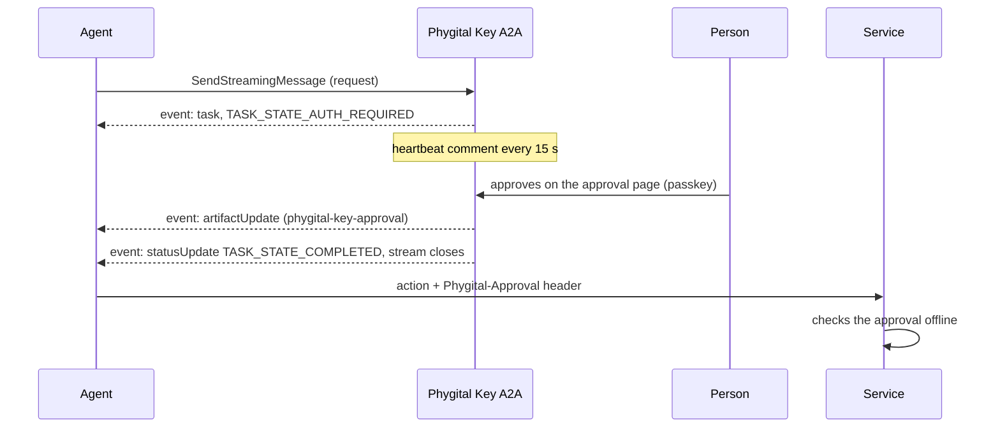

# Connect your agent

How any A2A 1.0 client talks to Phygital Key A2A: find the agent card, send the two headers, ask for an approval, and wait for the decision by polling or streaming. It is for developers who build agents. The exact methods and errors are in [protocol](protocol.md), and the message shapes in the [extension profile](extension.md).

**On this page:** [the agent card](#find-the-agent-card) · [headers](#send-the-two-headers) · [ask](#ask-for-an-approval) · [wait](#wait-for-the-decision) · [JavaScript](#javascript-with-a2a-jssdk) · [Python](#python-with-a2a-sdk) · [after the decision](#after-the-decision) · [from another machine](#from-another-machine)

## Find the agent card

The card is public, needs no token and holds no secret:

```bash
curl -s http://localhost:7478/.well-known/agent-card.json
```

The parts a client reads (from the v0.1.0 build):

```json
{
  "name": "Phygital Key A2A",
  "version": "0.1.0",
  "supportedInterfaces": [
    {"protocolBinding": "JSONRPC", "protocolVersion": "1.0", "url": "http://localhost:7478/a2a"}
  ],
  "capabilities": {
    "streaming": true,
    "pushNotifications": false,
    "extendedAgentCard": false,
    "extensions": [
      {"uri": "https://github.com/Phygital-Key/phygital-key-a2a/blob/main/docs/extension.md#v1", "required": false, "description": "..."}
    ]
  },
  "securitySchemes": {
    "bearer": {"httpAuthSecurityScheme": {"scheme": "Bearer", "description": "The gate's access token (run `phygital-key-a2a token`)."}}
  },
  "securityRequirements": [{"schemes": {"bearer": {"list": []}}}],
  "defaultInputModes": ["application/json", "text/plain"],
  "defaultOutputModes": ["application/json", "text/plain"],
  "skills": ["request_approval", "request_standing_approval", "use_standing_approval", "record_receipt", "revoke_standing_approval"]
}
```

(`skills` is shortened here to the ids; each skill has a name, a description, tags and one example data part.) The card comes with `Cache-Control: public, max-age=300`, an `ETag` (send `If-None-Match` and get `304` when it has not changed) and `Last-Modified`. The interface `url` follows the gate's origin, so with `--origin https://approve.example.com` it is `https://approve.example.com/a2a`.

## Send the two headers

Every call to the endpoint needs:

| Header | Value | Without it |
|---|---|---|
| `Authorization` | `Bearer <token>`, from `phygital-key-a2a token` (or `phygital-key-a2a-admin token` for the secure install) | `401` with ``{"error":"missing or wrong access token (see `phygital-key-a2a token`)"}`` |
| `A2A-Version` | `1.0` (a patch such as `1.0.1` is accepted; the query parameter `?A2A-Version=1.0` works too) | JSON-RPC error `-32009`: no header means version 0.3, which this agent does not speak |
| `Content-Type` | `application/json` or `application/a2a+json` (any case, parameters such as `charset` allowed) | `415` with JSON-RPC error `-32005` |

A call with a browser `Origin` header is refused with `403`, even with the token: web pages cannot drive the agent. The token is 43 characters and lives in `<home>/access-token` (mode 0600). Keep it out of prompts and logs.

## Ask for an approval

Send a message with one data part whose object has the key `request`:

```json
{
  "jsonrpc": "2.0",
  "id": 1,
  "method": "SendMessage",
  "params": {
    "message": {
      "messageId": "msg-1",
      "role": "ROLE_USER",
      "parts": [{
        "mediaType": "application/json",
        "data": {"request": {
          "request": {"type": "deploy", "params": {"service": "api", "env": "production", "version": "2.4.1"}},
          "aud": "https://deploy.example.com",
          "level": "high"
        }}
      }]
    }
  }
}
```

The answer is a task in `TASK_STATE_AUTH_REQUIRED`. Show the person the `approveUrl` from its status message (data part `{"approveUrl", "id"}`) or from `metadata[<extension URI>].approveUrl`. The other four shapes (`standing`, `use`, `receipt`, `revoke`): [extension profile](extension.md#messages-the-agent-accepts).

Requests must be exact: strings and integers only (no floats), Unicode NFC, no secrets (the person sees every field and anyone holding the approval can read it). The gate refuses anything else with a `ROLE_AGENT` message that says why, and no task is made. See [canonical form](https://github.com/Phygital-Key/phygital-key/blob/main/docs/canonical-form.md).

## Wait for the decision

The person decides on the approval page, out of band. Pick one way to learn the result:

| Way | Call | What you get |
|---|---|---|
| Poll | `GetTask` with `{"id": "<task id>"}`, every few seconds | The task, until its state is no longer `TASK_STATE_AUTH_REQUIRED` |
| Stream the request | `SendStreamingMessage` instead of `SendMessage` | Server-sent events: the task, then the result, then the stream closes |
| Subscribe | `SubscribeToTask` with `{"id": "<task id>"}` | The same events for a task you already have; several subscribers get the same events |

At most 32 streams are open at once on one gate. A 33rd `SendStreamingMessage` or `SubscribeToTask` answers `-32004` "too many open streams; poll with GetTask (at most 32 are open at once)", and a refused `SendStreamingMessage` makes no task, so you can send the same message again with `SendMessage` and poll.



Each event is a full JSON-RPC response with the id of your call, as `data:` in `text/event-stream`. A real `SubscribeToTask` stream that ended with a `CancelTask` (ids shortened, message parts cut):

```text
data: {"id":"sub-1","jsonrpc":"2.0","result":{"task":{"id":"oxAJXcHYKI-GniYsfDuiwA","status":{"state":"TASK_STATE_AUTH_REQUIRED",...},...}}}

data: {"id":"sub-1","jsonrpc":"2.0","result":{"statusUpdate":{"contextId":"FzmMJc3eJfGxR807ZFsi4g","status":{"state":"TASK_STATE_CANCELED","timestamp":"2026-10-18T04:55:29.282Z",...},"taskId":"oxAJXcHYKI-GniYsfDuiwA"}}}
```

On approval the stream sends an `artifactUpdate` with the approval artifact (`append: false`, `lastChunk: true`) and then a `statusUpdate` with `TASK_STATE_COMPLETED`. Any other end sends one `statusUpdate`. While the person decides, the stream carries a comment line every 15 seconds so proxies keep it open, and it closes after the 10 minute decision window at the latest. A message that makes no task (a refusal, a `use` answer) comes as one `message` event, then the stream closes.

With `curl`, add `-N` and `-H "Accept: text/event-stream"` to see the events as they come.

## JavaScript with @a2a-js/sdk

Tested with `@a2a-js/sdk` 1.3.0 and Node 26 against the demo. The client reads the card, picks the JSON-RPC interface and adds `A2A-Version: 1.0`; you add the token through `fetchImpl`.

```js
import { randomUUID } from "node:crypto";
import { SendMessageRequest, StreamResponse } from "@a2a-js/sdk";
import { ClientFactory, ClientFactoryOptions, JsonRpcTransportFactory } from "@a2a-js/sdk/client";

const GATE = process.env.GATE ?? "http://localhost:7478";
const SERVICE = process.env.SERVICE ?? "http://localhost:7479";
const token = process.env.PKA_TOKEN; // from `phygital-key-a2a token`

// Every call carries the access token. The client adds A2A-Version: 1.0 itself.
const authFetch = (url, init = {}) =>
  fetch(url, { ...init, headers: { ...(init.headers ?? {}), Authorization: `Bearer ${token}` } });

const factory = new ClientFactory(ClientFactoryOptions.createFrom(ClientFactoryOptions.default, {
  transports: [new JsonRpcTransportFactory({ fetchImpl: authFetch })],
}));
const client = await factory.createFromUrl(GATE); // reads /.well-known/agent-card.json

const request = SendMessageRequest.fromJSON({
  message: {
    messageId: randomUUID(),
    role: "ROLE_USER",
    parts: [{
      mediaType: "application/json",
      data: { request: {
        request: { type: "deploy", params: { service: "api", env: "production", version: "2.4.1" } },
        aud: SERVICE,
        level: "high",
      } },
    }],
  },
});

let approval;
for await (const ev of client.sendMessageStream(request)) {
  const e = StreamResponse.toJSON(ev);
  if (e.task) console.log("ask the person to open", e.task.status.message.parts[1].data.approveUrl);
  if (e.artifactUpdate) approval = e.artifactUpdate.artifact.parts[0].data.approval;
  if (e.statusUpdate) console.log("state:", e.statusUpdate.status.state);
}
if (!approval) process.exit(1); // rejected, canceled or failed: do not act

// Send the approval with the exact request to the service, once.
const res = await fetch(`${SERVICE}/deploy`, {
  method: "POST",
  headers: { "Content-Type": "application/json", "Phygital-Approval": approval },
  body: JSON.stringify({ service: "api", env: "production", version: "2.4.1" }),
});
console.log(res.status, (await res.json()).done);
```

To poll instead, call `client.sendMessage(request)` and then `client.getTask({ tenant: "", id })`. To follow a task you already have, `client.resubscribeTask({ tenant: "", id })` calls `SubscribeToTask`. The end-to-end tests use all three ([testing](testing.md)).

## Python with a2a-sdk

> [!IMPORTANT]
> Checked by hand once, with `a2a-sdk` 1.2.2 on Python 3.14 against the v0.1.0 demo: it printed the waiting task, the approval and `TASK_STATE_COMPLETED`. It is not part of the end-to-end tests or CI, so treat it as a sketch and check it against your SDK version.

```python
import asyncio, os, uuid

import httpx
from google.protobuf.json_format import MessageToDict, ParseDict

from a2a.client import ClientConfig, create_client
from a2a.types import SendMessageRequest

GATE = os.environ.get("GATE", "http://localhost:7478")
TOKEN = os.environ["PKA_TOKEN"]          # from `phygital-key-a2a token`
SERVICE = os.environ.get("SERVICE", "http://localhost:7479")


async def main():
    http = httpx.AsyncClient(headers={"Authorization": f"Bearer {TOKEN}"}, timeout=None)
    client = await create_client(GATE, ClientConfig(httpx_client=http, streaming=True))
    request = ParseDict({
        "message": {
            "messageId": str(uuid.uuid4()),
            "role": "ROLE_USER",
            "parts": [{
                "mediaType": "application/json",
                "data": {"request": {
                    "request": {"type": "deploy",
                                "params": {"service": "api", "env": "production", "version": "2.4.1"}},
                    "aud": SERVICE,
                    "level": "high",
                }},
            }],
        }
    }, SendMessageRequest())
    async for event in client.send_message(request):
        e = MessageToDict(event)
        if "task" in e:
            print("waiting:", e["task"]["metadata"])
        if "artifactUpdate" in e:
            approval = e["artifactUpdate"]["artifact"]["parts"][0]["data"]["approval"]
            print("approval:", approval[:24] + "...")
        if "statusUpdate" in e:
            print("state:", e["statusUpdate"]["status"]["state"])
    await http.aclose()


asyncio.run(main())
```

`timeout=None` turns off the httpx default of 5 seconds, because the stream stays open while the person decides, up to 10 minutes. The check above installed it with `pip install "a2a-sdk[http-server]==1.2.2"` (the extra adds only the server packages `starlette` and `sse-starlette`).

## After the decision

| State | Do |
|---|---|
| `TASK_STATE_COMPLETED` | Take `approval` from the artifact's data part and send it with the exact same request to the service named in `aud`, once, before `exp` (header `Phygital-Approval`, or the field the service names). For a standing approval, send a `use` message for each action first. |
| `TASK_STATE_REJECTED` | Do not act. Report that the person said no. |
| `TASK_STATE_CANCELED` | Do not act. |
| `TASK_STATE_FAILED` | Do not act. Ask again only if the person wants to. |

The service checks the approval itself, offline: [integrate](https://github.com/Phygital-Key/phygital-key/blob/main/docs/integrate.md). If another agent will call the service, pass the approval on as the [extension profile](extension.md#carrying-an-approval-to-another-agent) describes; that agent's service still checks it.

## From another machine

By default the gate listens on `127.0.0.1`. To reach it from agents on other machines, put it behind a TLS proxy and start it with `--origin https://your.host` ([own server](https://github.com/Phygital-Key/phygital-key/blob/main/docs/own-server.md)). On a public origin the agent card also answers with `Access-Control-Allow-Origin: *`; on `localhost` it sends no CORS header, so web pages cannot probe a local gate. The endpoint itself refuses every browser `Origin`, wherever it runs.

## Next

- [Protocol](protocol.md): methods, errors, task states, paging and limits.
- [Extension profile](extension.md): all five message shapes and the approval artifact.
- [Getting started](getting-started.md): the demo, step by step.
- [Approving](https://github.com/Phygital-Key/phygital-key/blob/main/docs/approving.md): what the person sees.
