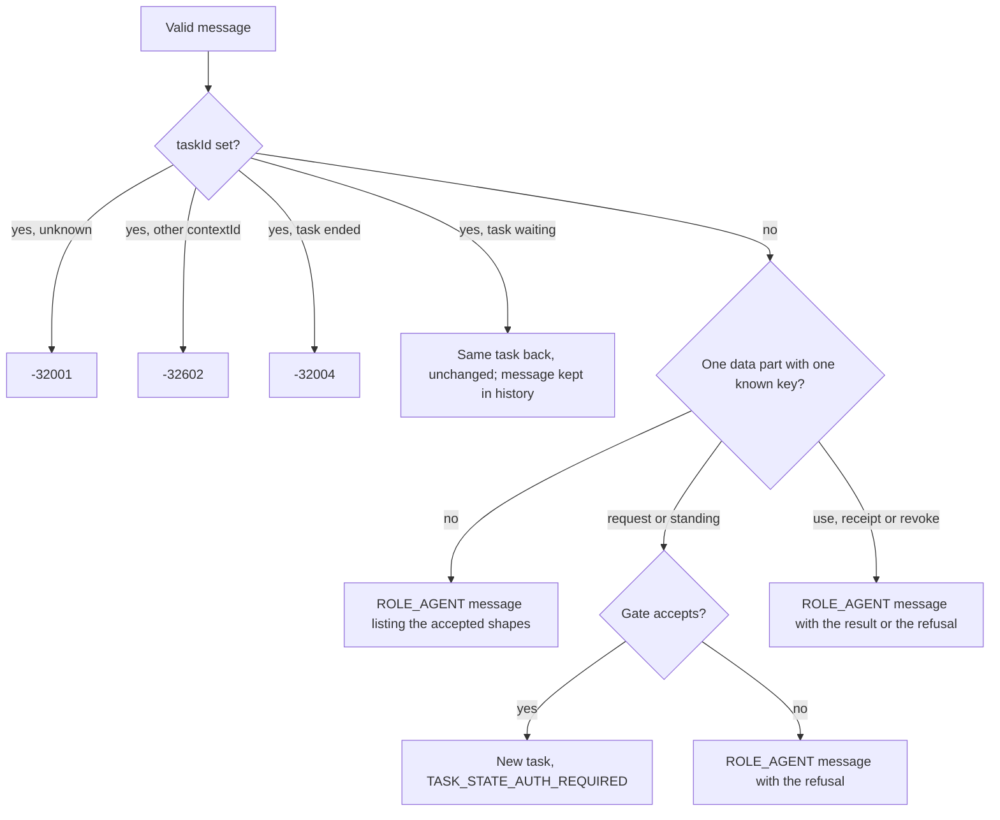

# Protocol

The A2A 1.0 JSON-RPC binding exactly as Phygital Key A2A implements it: the transport checks, every method, every error, the task states, `ListTasks` paging, history, streams and limits. It is for developers of A2A clients and for reviewers. What the message shapes mean and what the approval artifact holds is in the [extension profile](extension.md); how to connect, in [connect your agent](connect-your-agent.md). Everything here is from `src/` of v0.1.0 and was checked against the running program.

**On this page:** [transport](#transport) · [the envelope](#the-json-rpc-envelope) · [methods](#methods) · [errors](#errors) · [SendMessage](#sendmessage-and-sendstreamingmessage) · [tasks](#tasks-and-their-states) · [GetTask and CancelTask](#gettask-and-canceltask) · [ListTasks](#listtasks) · [streams](#streams) · [limits](#limits)

## Transport

| What | Value |
|---|---|
| Binding | JSON-RPC 2.0 over HTTP, the only interface in the agent card. No gRPC, no HTTP+JSON (REST), no stdio. |
| Endpoint | `POST /a2a` (also `POST /a2a/`) |
| Agent card | `GET /.well-known/agent-card.json`, public |
| Protocol version | `1.0`, from the `A2A-Version` header or the `A2A-Version` query parameter |
| Request body | `Content-Type: application/json` or `application/a2a+json`, at most 64 KiB |
| Responses | `application/json`, or `text/event-stream` for the two streaming methods |

A request goes through these checks, in this order. The first three come from the shared guard in the base ([architecture](https://github.com/Phygital-Key/phygital-key/blob/main/docs/architecture.md)); the rest are this adapter's.

| # | Check | Refusal |
|:-:|---|---|
| 1 | The `Host` header is the gate's own host | `421` `{"error":"unknown host"}` |
| 2 | No `Origin` header (no browser) | `403` `{"error":"browser requests are not allowed here"}` |
| 3 | `Authorization: Bearer <token>` matches (compared in constant time; `bearer` in any case). Always on in a release: a release build refuses `--no-token` (see below). | `401` ``{"error":"missing or wrong access token (see `phygital-key-a2a token`)"}`` |
| 4 | Method is `POST` | `405` |
| 5 | Body at most 64 KiB | `413` (plain text) |
| 6 | `Content-Type` is `application/json` or `application/a2a+json`, in any case, with or without parameters such as `; charset=utf-8` | `415` with JSON-RPC error `-32005`, `id: null` |
| 7 | The body is one JSON-RPC 2.0 request | `-32700` or `-32600`, see below |
| 8 | `A2A-Version` is `1.0` or `1.0.<patch>` (spaces around it are ignored) | `-32009` |

From check 7 on, errors are JSON-RPC error responses with HTTP status `200`.

> [!NOTE]
> A release build never serves the endpoint without the token. `phygital-key-a2a serve --no-token` (or `demo --no-token`) prints `phygital-key-a2a: --no-token is not allowed: anyone on this machine could read approvals. Use the access token (phygital-key-a2a token).` and exits with code 2, before anything starts. Only the test-only `tck` build, used for the [conformance kit](testing.md#a2a-conformance-kit), accepts `--no-token`.

When the request has the header `A2A-Extensions` listing this agent's extension URI, the response carries `A2A-Extensions: https://github.com/Phygital-Key/phygital-key-a2a/blob/main/docs/extension.md#v1`. The extension is optional: requests without the header work the same.

## The JSON-RPC envelope

| Rule | Error |
|---|---|
| The body is JSON | `-32700` "Parse error: the body is not valid JSON", `id: null` |
| It is one object (batches are not supported) | `-32600` "Invalid Request: batch requests are not supported, send one request per call", `id: null` |
| `id` is a string or a number (`null`, missing, objects are refused) | `-32600` "Invalid Request: id must be a string or a number", `id: null` |
| `jsonrpc` is `"2.0"` | `-32600`, with your `id` |
| `method` is a string | `-32600`, with your `id` |
| `params` is an object, or absent (absent means `{}`) | `-32602` "Invalid params: params must be an object" |

Every response echoes your `id`. Field names may be in proto form too: `history_length`, `include_artifacts`, `page_size`, `message_id`, `media_type` and the like are read as `historyLength` and so on in the params, the `configuration`, the `message` and its parts (the camelCase name wins when both are sent). Data you own is never renamed: the content of `data` parts and `metadata` stays as you sent it.

## Methods

| Method | Answer |
|---|---|
| `SendMessage` | `{"task": Task}` or `{"message": Message}` |
| `SendStreamingMessage` | A stream of `{"task"}`, `{"artifactUpdate"}`, `{"statusUpdate"}` or one `{"message"}` |
| `GetTask` | `Task` |
| `ListTasks` | `{"tasks", "nextPageToken", "pageSize", "totalSize"}` |
| `CancelTask` | `Task` in `TASK_STATE_CANCELED` |
| `SubscribeToTask` | A stream: the current task first, then its changes |
| `GetExtendedAgentCard` | Error `-32004`: there is no extended card |
| `CreateTaskPushNotificationConfig`, `GetTaskPushNotificationConfig`, `ListTaskPushNotificationConfigs`, `DeleteTaskPushNotificationConfig` | Error `-32003`: push notifications are not supported |
| Anything else, including the 0.3 names such as `message/send` | Error `-32601` "Method not found: `<name>`" |

## Errors

A2A errors carry one `google.rpc.ErrorInfo` in `data`, with `domain` `a2a-protocol.org`:

```json
{"error":{"code":-32001,"data":[{"@type":"type.googleapis.com/google.rpc.ErrorInfo","domain":"a2a-protocol.org","metadata":{"taskId":"nope"},"reason":"TASK_NOT_FOUND"}],"message":"Task not found"},"id":8,"jsonrpc":"2.0"}
```

| Code | `reason` | `metadata` | When |
|---|---|---|---|
| `-32700` | none | | The body is not JSON |
| `-32600` | none | | Not a single valid JSON-RPC 2.0 request |
| `-32601` | none | | Unknown method |
| `-32602` | none | | Bad params: a missing `id`, a bad `message`, a bad `configuration`, `ListTasks` values out of range, a `taskId` with another task's `contextId` |
| `-32001` | `TASK_NOT_FOUND` | `{"taskId"}` | No task with that id (never made, forgotten, or made before a restart) |
| `-32002` | `TASK_NOT_CANCELABLE` | `{"taskId"}` | `CancelTask` on a task that has ended, or that the person decided a moment before |
| `-32003` | `PUSH_NOTIFICATION_NOT_SUPPORTED` | | The four push methods, or a `configuration.taskPushNotificationConfig` |
| `-32004` | `UNSUPPORTED_OPERATION` | | `GetExtendedAgentCard`; a message to an ended task; `SubscribeToTask` on an ended task; a 33rd open stream |
| `-32005` | `CONTENT_TYPE_NOT_SUPPORTED` | | A request body that is neither `application/json` nor `application/a2a+json` (HTTP `415`); `acceptedOutputModes` that this agent cannot produce |
| `-32009` | `VERSION_NOT_SUPPORTED` | `{"supportedVersions": "1.0"}` | No `A2A-Version` (that means 0.3), or any version but `1.0.x` |

A captured `-32009`, for a call without the header:

```json
{"error":{"code":-32009,"data":[{"@type":"type.googleapis.com/google.rpc.ErrorInfo","domain":"a2a-protocol.org","metadata":{"supportedVersions":"1.0"},"reason":"VERSION_NOT_SUPPORTED"}],"message":"A2A version 0.3 (no A2A-Version header) is not supported: send the header A2A-Version: 1.0 (no header means 0.3)"},"id":3,"jsonrpc":"2.0"}
```

JSON-RPC errors are kept for protocol mistakes. When a well-formed message asks for something the gate refuses (no key enrolled, a float in the params, a use outside the limits, too many requests), the answer is a successful result with a `ROLE_AGENT` message that holds the reason twice: as text, and as `{"error": "..."}` data. No task is made. For example:

```json
{"id":17,"jsonrpc":"2.0","result":{"message":{"contextId":"_0sc5wskmOCFwQF5E89yXg","messageId":"xMgB7X9CmWoIcuQ6pdOqqA","parts":[{"mediaType":"text/plain","text":"request has no canonical form: use strings or integers, never floats"},{"data":{"error":"request has no canonical form: use strings or integers, never floats"},"mediaType":"application/json"}],"role":"ROLE_AGENT"}}}
```

## SendMessage and SendStreamingMessage

Both take `{"message": Message, "configuration"?: {...}, "metadata"?: {...}}`.

The message must have:

| Field | Rule (else `-32602`) |
|---|---|
| `messageId` | 1 to 256 visible ASCII characters |
| `role` | `"ROLE_USER"` |
| `parts` | 1 to 16 parts, each an object with exactly one of `text`, `raw`, `url` or `data`; `text` must be a string |
| `contextId`, `taskId` | optional, same rule as `messageId` |

`configuration` may hold:

| Field | Effect |
|---|---|
| `historyLength` | Integer, 0 or more: how many history messages the returned task carries |
| `returnImmediately` | `true` or `false`. It changes nothing: a new task is at once in `TASK_STATE_AUTH_REQUIRED`, an interrupted state, so the answer always comes at once. |
| `acceptedOutputModes` | If not empty, it must include one of `application/json`, `text/plain`, `*/*`, `application/*`, `text/*`, else `-32005` |
| `taskPushNotificationConfig` | Anything but `null` gives `-32003` |

What happens next:



The accepted shapes (`request`, `standing`, `use`, `receipt`, `revoke`) and their fields are in the [extension profile](extension.md#messages-the-agent-accepts). Text parts are ignored, whatever they say. A file part (`raw` or `url`), two data parts, a data part with another `mediaType`, a data object with zero or two keys, an unknown key or an unknown field each get the help message, which names the problem and lists the shapes.

If you send no `contextId`, the agent makes one. Messages that make no task carry a `contextId` but no `taskId`.

## Tasks and their states

```json
{
  "id": "<the gate's request id>",
  "contextId": "<yours, or one the agent made>",
  "status": {"state": "TASK_STATE_AUTH_REQUIRED", "message": {...}, "timestamp": "2026-10-18T04:55:27.931Z"},
  "artifacts": [...],
  "history": [...],
  "metadata": {"https://github.com/Phygital-Key/phygital-key-a2a/blob/main/docs/extension.md#v1": {"approveUrl": "...", "type": "approval"}}
}
```

The wire format is ProtoJSON: camelCase names, `TASK_STATE_*` and `ROLE_*` enum strings, parts without a `kind`. `metadata[<URI>].type` is `approval` (one-time) or `standing`. `artifacts` appears only on a completed task.

| Gate status | Task state | Status message text starts with |
|---|---|---|
| waiting | `TASK_STATE_AUTH_REQUIRED` | "Ask the person to open `<approveUrl>` and approve or deny ..." |
| approved, and the gate handed out its approval string | `TASK_STATE_COMPLETED` | "Approved." (standing: "Approved standing approval.") |
| denied | `TASK_STATE_REJECTED` | "The person said no. Do not perform the action." |
| cancelled | `TASK_STATE_CANCELED` | "Cancelled. Do not perform the action." |
| expired | `TASK_STATE_FAILED` | "Expired: nobody decided in time." or "Expired: the approval ran out before it was collected." |
| unknown to the gate | `TASK_STATE_FAILED` | "Failed: the gate no longer has this request (it expired or was forgotten). Do not perform the action." |

The status message is a `ROLE_AGENT` message with `messageId` `<task id>-<state>` (for example `Kr29xbXDUrjsMZyj0tdlug-auth_required`). In every state but `COMPLETED` it has a second, data part `{"approveUrl", "id"}`. `TASK_STATE_SUBMITTED`, `WORKING` and `INPUT_REQUIRED` are never used by the release build.

Three rules hold for every task. Unit tests in `src/proto.rs` and `src/store.rs` check the first two, and the end-to-end checks all three:

- A task is `COMPLETED` only when the gate gave out its approval string, never on a status alone.
- A task leaves `TASK_STATE_AUTH_REQUIRED` once. An ended task never changes again: a completed standing approval stays `COMPLETED` after a revoke, and a completed task stays `COMPLETED` after its approval's `exp`.
- `status.timestamp` is ISO 8601 UTC with milliseconds and `Z`, and moves to the time of the change.

### History

The history is the client's messages on the task, oldest first: the one that made it, then follow-ups sent with its `taskId`. Each history message carries the task's `taskId` and `contextId`, and only the fields A2A defines (unknown fields you sent are not echoed). Everything kept is capped:

| What | What is kept |
|---|---|
| The first message | Its A2A fields. Each text part is cut to 2048 bytes; a `metadata`, `extensions` or `referenceTaskIds` value over 2 KB is left out (also a part's `metadata`, `filename` or `mediaType` over 2 KB). The whole message is at most 32 KB: over that, the optional members go first, then part metadata, then text parts from the end. |
| A follow-up | Only `messageId`, `role` and the text of its text parts, 2048 bytes in all. Never its `metadata`, data parts or file parts. |
| One task | At most 20 messages and 64 KB. The first message always stays; past a limit, the oldest follow-ups go first. |
| All tasks | At most 16 MB of history. When it is full, the oldest follow-ups of ended tasks go first. If that frees no room, the follow-up is not kept, and the answer is a `ROLE_AGENT` message (with the `taskId`): "This message was not kept: the agent holds as many follow-up messages as it can right now. Nothing said here changes the task: the person decides on the approval page. Poll with GetTask." |

`historyLength` limits the history to the latest n messages; `0` leaves `history` out. In `GetTask`, the streams and the send `configuration`, an absent `historyLength` means all (within the caps). In `ListTasks` the default is `0`: no history unless you ask.

## GetTask and CancelTask

Both take `{"id": "<task id>"}` (a missing or empty `id` is `-32602`). `GetTask` also takes `historyLength`. Each call asks the gate for the latest status of a waiting task first, so a poll sees a decision at once.

`CancelTask` on a waiting task withdraws the request at the gate and returns the task in `TASK_STATE_CANCELED`; the approval page then refuses to approve it (HTTP `409`). On an ended task it answers `-32002`, also when the person decided a moment before the cancel arrived.

## ListTasks

Lists the tasks made through this agent since it started.

| Param | Type | Default | Rule (else `-32602`) |
|---|---|---|---|
| `contextId` | string | all | |
| `status` | `TaskState` string | all | One of the eight `TASK_STATE_*` names; `TASK_STATE_UNSPECIFIED` means no filter |
| `statusTimestampAfter` | ISO 8601 string | all | `Z` or `+HH:MM` offset, any fraction. Keeps tasks whose status changed at or after it. |
| `pageSize` | integer | 50 | 1 to 100 |
| `pageToken` | string | first page | A `nextPageToken` from this agent |
| `includeArtifacts` | boolean | `false` | |
| `historyLength` | integer | `0` (no history) | 0 or more |

An empty string counts as absent. Tasks come newest status first (by `status.timestamp`, then by creation order). `totalSize` counts every task that matches the filters; `nextPageToken` is `""` on the last page. Without `includeArtifacts: true`, tasks come without `artifacts`; `SendMessage`, `GetTask` and the streams always include them.

A captured first page with `pageSize: 2` (tasks cut to their ids and states):

```json
{"id":18,"jsonrpc":"2.0","result":{"nextPageToken":"MTc5MjI5OTMyOTI4Mjo1","pageSize":2,"tasks":[{"id":"_Ho5ACSkRJ9Eg4-lY7knKw","status":{"state":"TASK_STATE_COMPLETED",...},...},{"id":"oxAJXcHYKI-GniYsfDuiwA","status":{"state":"TASK_STATE_CANCELED",...},...}],"totalSize":6}}
```

Pass `nextPageToken` as `pageToken` for the next page. Paging through gives every task once (an end-to-end check tests it). Treat the token as opaque.

## Streams

`SendStreamingMessage` and `SubscribeToTask` answer `200` with `text/event-stream`. Each event is `data: <a full JSON-RPC response with your id>`.

At most 32 streams are open at once, across both methods. Past that, both answer `-32004` "too many open streams; poll with GetTask (at most 32 are open at once)". The check comes before the message is acted on, so a refused `SendStreamingMessage` makes no task. A place frees as soon as a stream ends or its client closes it.

1. The first event is `{"task": Task}`. (When the message makes no task, the only event is `{"message": Message}`, and the stream closes.)
2. While the task waits, a comment line goes out every 15 seconds.
3. On approval: `{"artifactUpdate": {"taskId", "contextId", "artifact", "append": false, "lastChunk": true}}`, then `{"statusUpdate": {"taskId", "contextId", "status"}}` with `TASK_STATE_COMPLETED`. On any other end: one `statusUpdate`.
4. The stream closes after the terminal state, or 10 minutes after it opened at the latest.

Every stream of a task sends the same events in the same order. `SubscribeToTask` on an ended task answers `-32004` (use `GetTask`); on an unknown task, `-32001`. A JSON-RPC error on a streaming method is a plain JSON response, not an event stream.

## Limits

| Limit | Value | Where |
|---|---|---|
| Request body | 64 KiB | `src/server.rs` |
| Parts per message | 16 | `src/intent.rs` |
| `messageId`, `contextId`, `taskId` | 1 to 256 visible ASCII characters | `src/intent.rs` |
| First message in history | text parts 2048 bytes each, metadata 2 KB, 32 KB in all | `src/intent.rs` |
| Follow-up in history | `messageId`, `role` and 2048 bytes of text | `src/intent.rs` |
| History per task | 20 messages and 64 KB | `src/store.rs` |
| History, all tasks | 16 MB | `src/store.rs` |
| Open streams | 32 | `src/server.rs` |
| Tasks kept | 5000 (the oldest ended tasks go first) | `src/store.rs` |
| Ended tasks | forgotten 24 hours after they ended | `src/store.rs` |
| Where tasks live | in memory: a restart forgets them, and `GetTask` then answers `-32001` | `src/store.rs` |
| Decision window | 10 minutes, then `TASK_STATE_FAILED` | base |
| Approval life | 60 seconds after the person approves (`--lifetime`, at most 300) | base |
| Use token life | 60 seconds, one use | base |
| New requests | 30 a minute, 50 waiting at once | base |
| Standing approval | 1 to 1000 uses, 1 to 30 days | base |
| Heartbeat on streams | every 15 seconds | `src/server.rs` |
| Agent card cache | `max-age=300` | `src/card.rs` |

The gate's own request store, flood limits and request rules: [reference](https://github.com/Phygital-Key/phygital-key/blob/main/docs/reference.md) and [canonical form](https://github.com/Phygital-Key/phygital-key/blob/main/docs/canonical-form.md).

## Next

- [Extension profile](extension.md): the message shapes, the artifact, carrying approvals.
- [Connect your agent](connect-your-agent.md): clients, polling and streaming.
- [Testing](testing.md): the checks behind each rule, and the conformance kit.
- [Threat model](https://github.com/Phygital-Key/phygital-key/blob/main/docs/threat-model.md)
