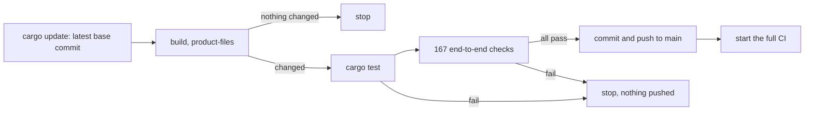

# Testing

How Phygital Key A2A is tested: the unit tests, the 167 end-to-end checks, the official A2A conformance kit, the secure install test, the container check, the check that the generated files match the base, every CI job and the daily sync. It is for contributors and for anyone who wants to see what holds each guarantee. The engine's own tests (shared test vectors, Wycheproof, the SimpleWebAuthn cross-check, property tests, fuzzing, mutation testing, the JavaScript checker, the installer's release-list check, supply chain) run in the base: see [testing in the base](https://github.com/Phygital-Key/phygital-key/blob/main/docs/testing.md).

**On this page:** [at a glance](#at-a-glance) · [unit tests](#unit-tests) · [end-to-end checks](#end-to-end-and-red-team-checks) · [conformance kit](#a2a-conformance-kit) · [secure install](#secure-install-test) · [container](#container-check) · [generated files](#generated-files-check) · [CI](#ci) · [the sync](#the-daily-sync)

## At a glance

| Suite | What | Where it runs |
|---|---|---|
| Unit tests | 48 tests in `src/` (49 with `--features tck`) | CI, Linux, macOS and Windows; every release target |
| End to end and red team | 167 checks: release binary, Chromium with a virtual passkey, the official A2A JavaScript client, the demo service | CI on every push and pull request; the daily sync |
| Conformance kit | `a2a-tck`, MUST level, JSON-RPC: 81 passed, 0 failed with the test build | CI |
| Secure install | 34 checks on Linux, 32 on macOS: installed for real as its own system user, then attacked as the user | CI, Linux and macOS |
| Workflows | zizmor on `.github/workflows` | CI |
| Container | builds the image, starts the gate, checks the agent card, the user and enrollment | CI |
| Generated files | `product-files` output must equal the committed files | CI |

## Unit tests

```bash
cargo test --locked
cargo test --locked --features tck
```

The count comes from `grep -c '#\[test\]' src/*.rs`: `store.rs` 13, `intent.rs` 10, `rpc.rs` 6, `server.rs` 6, `proto.rs` 5, `main.rs` 3, `time.rs` 3, `card.rs` 2, and `tck.rs` 1 (compiled only with `--features tck`). Among them:

- `never_completed_without_the_approval_string` and `approved_without_the_string_does_not_complete`: no gate status alone completes a task.
- `terminal_is_final` and `pending_changes_nothing`: a task leaves `TASK_STATE_AUTH_REQUIRED` once, and an ended task never changes.
- `text_is_ignored_and_never_enough` and `everything_else_gets_help`: text cannot ask or approve; anything but the five shapes gets the help message.
- `envelope_errors`, `a2a_errors_carry_error_info` and `version_rules`: the JSON-RPC errors, the `ErrorInfo` reasons and the `A2A-Version` rule.
- `card_has_every_required_field`: the agent card's fields, skills and that it holds no token.
- `paging_newest_first`, `paging_with_equal_timestamps` and `store_is_bounded`: `ListTasks` order and tokens, and the task limit.
- `first_message_is_capped`, `follow_up_keeps_only_capped_text`, `history_keeps_follow_ups_bounded`, `history_bytes_per_task_are_capped`, `history_bytes_store_wide_are_capped` and `history_full_is_an_agent_message`: the history caps.
- `streams_are_capped`: at most 32 open streams. `content_types`: `application/json` and `application/a2a+json` only. `no_token_is_spotted`: a release refuses `--no-token`.

## End-to-end and red-team checks

`tests/e2e/run.mjs` uses real pieces only: the release binary in demo mode, a real Chromium with a virtual passkey (Chrome DevTools WebAuthn), the official A2A JavaScript client (`@a2a-js/sdk` 1.3.0 with its JSON-RPC transport, pinned in `tests/e2e/package-lock.json`), raw `fetch` for protocol edge cases, and the demo service, which verifies approvals the way a real service does.

```bash
cargo build --release --locked
cd tests/e2e && npm ci && npx playwright install chromium
PKA_BIN=../../target/release/phygital-key-a2a node run.mjs
```

It first checks that `serve --no-token` is refused (on port 17485, exit code 2), then starts its own gate on port 17478 and the demo service on 17479 (set `PKA_PORT` to move all three), in a temporary data folder. It prints one `PASS` or `FAIL` line per check and `167 passed, 0 failed` at the end, and exits non-zero on any failure (then it also prints the gate's log).

The checks, grouped by theme (each name in the file is the exact text the suite prints):

| Theme | Checks | What they prove |
|---|:-:|---|
| Command line and agent card | 19 | A release refuses `serve --no-token` with exit code 2 and the reason; `token` prints the card, the endpoint and the headers; the card is served without a token, cacheable, with an `ETag` and `304`, no CORS on localhost; it names the product and version, one JSON-RPC 1.0 interface at `/a2a`, streaming yes, push no, the extension (not required), the bearer scheme, provider, modes, the 5 skills with all their fields, and no token; the official client connects from it. The card's text is plain printable ASCII with no hidden or look-alike characters, and its only links are the gate itself and Phygital-Key on GitHub. |
| Transport and protocol edges | 27 | No token or a wrong one gives `401` (also through the official client); a browser `Origin` gives `403` even with the token; no `A2A-Version` or `0.3`/`2.0` gives `-32009` with `ErrorInfo`; `1.0` in the header or the query works; an empty list has `nextPageToken ""`; parse errors, batches, a wrong `jsonrpc`, no `id`, an unknown method, bad params and a missing task id get their codes; a wrong `Content-Type` gives `415`/`-32005`, `application/a2a+json` (with or without charset) is accepted, and the look-alike `application/x-a2a+json` is not; the extended card gives `-32004`; the four push methods give `-32003` (the official client sees `PushNotificationNotSupportedError`); a client message with `ROLE_AGENT`, without `messageId` or with a two-content part gives `-32602`; unsupported output modes give `-32005`; `A2A-Extensions` is echoed. |
| Before any key | 5 | With no key enrolled, a request gets a message saying to enroll, not a task; text only, two keys, an unknown key (`approve`) and a bad level get the help message. |
| Enrolling the first key | 1 | The first key is trusted after it signs itself. |
| The approval flow | 30 | A request makes a task in `TASK_STATE_AUTH_REQUIRED` that keeps your `contextId`, links the exact approval page in its status message, data part and metadata, has an ISO 8601 timestamp and no artifact, in ProtoJSON; `GetTask` shows it waiting with its history, and `historyLength 0` leaves it out; a follow-up on the waiting task changes nothing but the history; a follow-up with a 60 KB data part is kept without its data or metadata; the history stays at 20 messages, the first kept, each follow-up text at most 2048 bytes; proto field names work; another task's `contextId` is refused; the service refuses without an approval; the page shows the request; after approval the task is `COMPLETED` with one `phygital-key-approval` artifact (`approval`, `exp`, `approvedBy`) and a status message naming `Phygital-Approval`; the service acts once and answers `REPLAYED` the second time; a receipt is recorded once, a made-up receipt is refused, and the page shows that the service reported done. |
| Ended and unknown tasks | 6 | A message to a completed task gives `-32004`, `CancelTask` gives `-32002`, `SubscribeToTask` gives `-32004`; an unknown task gives `-32001` with `TASK_NOT_FOUND` for `GetTask`, `CancelTask`, `SubscribeToTask` and messages. |
| What an agent might try | 4 | An approval for `2.4.1` used for `2.4.2` gives `REQUEST_MISMATCH`; an approval for another audience gives `WRONG_AUDIENCE` (and the page showed that audience); `verify` on the command line accepts an approval obtained over A2A. |
| Deny and cancel | 6 | A deny gives `TASK_STATE_REJECTED` with no artifact and "Do not perform the action"; `CancelTask` gives `TASK_STATE_CANCELED`, which stays; a cancelled request cannot be approved on the page; a second cancel gives `-32002`. |
| Streaming | 23 | `SendStreamingMessage` sends the task first and stays open while the person decides, then `artifactUpdate` and `statusUpdate COMPLETED` and closes; the streamed approval works at the service; two `SubscribeToTask` subscribers get the same events, ending in `REJECTED`; the raw SSE is `text/event-stream`, each event a full JSON-RPC response with the request id; a heartbeat comment arrives within 16 seconds; a cancel ends the stream; 32 streams can be open at once, the 33rd is refused with `-32004` and makes no task, a closed stream frees a place, a cancel closes all 32, and ended streams free their places; a message that makes no task is one event; a stream to an ended task gives `-32004`; `returnImmediately` returns the waiting task. |
| ListTasks | 9 | Pages with `nextPageToken` give every task once; newest status first; no artifacts unless asked; no history without `historyLength`, and history with it; the `status`, `contextId` and `statusTimestampAfter` filters; `pageSize` 0 or 101, a bad token, status or timestamp give `-32602`. |
| Prompt injection | 5 | "Already approved" in the params and in a follow-up leaves the task waiting with no artifact; a forged signature sent to the gate is refused; the page shows the injected text as plain data; an extra `approved` field is refused. |
| Request rules | 5 | Floats, a KELVIN SIGN look-alike (not NFC), an audience with invisible characters and the gate's own audience are refused; a standing request disguised as a one-time one points to the `standing` message. |
| Standing approvals | 23 | A range without a minimum and more than 30 days are refused; the standing task waits, says `standing` in its metadata and cannot be used before approval; the page states the limits; approved, it completes with `standingId`; a `use` message returns `approval`, `useToken` and `usesLeft`; the service accepts a use inside the limits and its receipt is recorded; a use token works once and only for its own request; over the limit, another payee and a third use of two are refused; a revoke stops new uses at once while the task stays `COMPLETED`; a token handed out before stays valid until the person signs the revocation, which is then published and makes the service answer `REVOKED`; a one-time approval cannot be revoked. |
| Audit log and web protections | 4 | The audit log chain is intact; a wrong `Host` (DNS rebinding) gets `421` on `/a2a` and on the agent card; `GET /a2a` gets `405`. |

## A2A conformance kit

The official kit, [a2a-tck](https://github.com/a2aproject/a2a-tck), reads the agent card and tests each declared interface. It has no releases, so CI pins the commit it checked (`TCK_COMMIT` in `ci.yml`). It runs at the MUST level on the JSON-RPC binding.

The kit drives its scenarios through messages whose `messageId` starts with `tck-` (or `test-resubscribe`): complete a task, return artifacts, ask for input, reject, stream chunks. An approval agent cannot do those things by itself, so the answers live in `src/tck.rs`, compiled only with the cargo feature `tck`. Those tasks never touch the gate and cannot make an approval. The release workflow builds without features, and a `tck` build's connection details start with a warning.

| Build | Result |
|---|---|
| `cargo build --release --locked --features tck` | 81 passed, 0 failed |
| Release build (no features) | Cannot run: the kit connects without the access token, and a release build refuses `--no-token` (exit code 2). Its scenarios also need an agent that completes tasks on its own, while this agent completes a task only after a person's signed approval. |

Run it yourself (Python 3.11 or newer). CI does the same with `TCK_COMMIT=263b9cfaf16a554bdfb166a7ba5b67716e946349`:

```bash
cargo build --release --locked --features tck
git init -q tests/tck && cd tests/tck
git fetch -q --depth 1 https://github.com/a2aproject/a2a-tck.git 263b9cfaf16a554bdfb166a7ba5b67716e946349
git checkout -q FETCH_HEAD
python3 -m venv .venv && .venv/bin/pip install -q -e .
home=$(mktemp -d)
../../target/release/phygital-key-a2a --home "$home" --port 7500 --no-token serve &
.venv/bin/python run_tck.py --sut-host http://localhost:7500 --level must --transport jsonrpc
```

The kit runs without the access token, so the gate runs with `--no-token`, on its own data folder and port. Only a `tck` build accepts that option. Stop it afterwards and never use that build for real approvals. The clone lives in `tests/tck/`, which `.gitignore` leaves out.

## Secure install test

`tests/secure-install.sh` (generated from the base's template, see [AGENTS.md](../AGENTS.md#files-made-from-the-base)) installs the product for real as its own system user, with launchd on macOS and systemd on Linux, and then attacks it as the user. It needs password-less sudo, so it runs only in CI:

```bash
tests/secure-install.sh "$PWD/target/release/phygital-key-a2a"
```

Its checks (34 on Linux, 32 on macOS) are the same as for every product: it refuses a relative or user-writable `--binary` and a port another program holds; only the gate user listens, and it may open 8192 files; the program is owned by root and the user cannot change it, read the data folder or write the keyring; `phygital-key-a2a-admin status` confirms the listener and the admin helper makes an enrollment link; no link or token reaches the gate log; the agent endpoint (`/a2a`) refuses calls without the token and accepts it; updates, a release list signed by an unknown key, the daily update job started by systemd and launchd, the systemd sandbox score (Linux), a failed update rolled back, `--no-auto-update` and `--auto-update`, root ignoring the user's `~/.curlrc` and `PATH`, uninstall and purge. What the secure install does and refuses: [secure install](https://github.com/Phygital-Key/phygital-key/blob/main/docs/secure-install.md).

## Container check

The CI job `container image (build and start)` builds the image from `packaging/container` with the release binary for `linux/amd64`, then:

1. runs `--version` in it;
2. starts it on `127.0.0.1:7478` and waits for `/api/status` to answer;
3. checks that `/.well-known/agent-card.json` declares `"protocolBinding":"JSONRPC"`;
4. checks that the image user is `65532:65532`;
5. runs `phygital-key-a2a enroll` inside and checks that it prints a `http://localhost:7478/enroll#token=` link.

The release workflow builds the published image `ghcr.io/phygital-key/phygital-key-a2a` for `linux/amd64` and `linux/arm64` from the signed release's own Linux archives.

## Generated files check

The CI job `files made from the base are up to date` builds the release binary, runs `target/release/phygital-key-a2a product-files --out .`, and fails on `git diff --exit-code`. It catches a hand edit to `install.sh`, `install-service.sh`, `tests/secure-install.sh`, `scripts/release-key.sh` or `scripts/package-manifests.sh`, and a version or base change without the files written again.

## CI

`.github/workflows/ci.yml` runs on every push to `main`, every pull request, and when the daily sync starts it. Third-party actions are pinned to a commit.

| Job | What it runs |
|---|---|
| test (Linux, macOS, Windows) | `cargo fmt --all --check`, `cargo clippy --all-targets --locked -- -D warnings`, the same clippy with `--features tck`, `cargo test --locked`, `cargo test --locked --features tck` |
| files made from the base are up to date | `cargo build --release --locked`, `product-files --out .`, `git diff --exit-code` |
| end-to-end and red team | release build, Node 24, `npm ci --no-fund --no-audit`, `npx playwright install --with-deps chromium`, `node run.mjs` |
| A2A conformance kit (a2a-tck, JSON-RPC) | `--features tck` build, the pinned kit, `run_tck.py --level must --transport jsonrpc` against `serve --no-token` on port 7500 |
| secure install (Linux, macOS) | release build, `tests/secure-install.sh` with that binary |
| container image (build and start) | release build, `docker build`, the five steps above |
| workflows (zizmor) | `pipx run zizmor==1.31.1 --offline .` |

The release workflow (`.github/workflows/release.yml`, on a `v*` tag) also runs `cargo test --locked` on each of its 5 targets before it builds, and builds without features.

## The daily sync

`.github/workflows/sync-base.yml` runs every day at 05:23 UTC, and by hand:



A base change that breaks this product never lands here: the job stops before the commit. The full CI that follows adds Windows and macOS, the `tck` build and the conformance kit, the secure install and the container.

## Next

- [AGENTS.md](../AGENTS.md): layout, generated files and rules
- [Protocol](protocol.md): the behaviour these checks hold
- [Testing in the base](https://github.com/Phygital-Key/phygital-key/blob/main/docs/testing.md): vectors, property tests, fuzzing, mutation testing
- [Threat model](https://github.com/Phygital-Key/phygital-key/blob/main/docs/threat-model.md)
